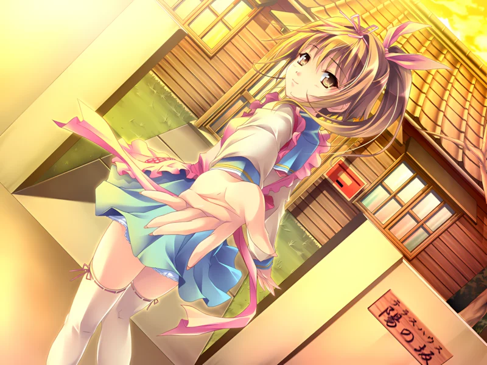

    
    <h1>damekoi_chs_l10n</h1>
    
Work in Progress...

## 汉化范围

- **已汉化**：对话、人名、选项
- **未汉化**：窗口标题、部分按钮

## 安装

将 `patch/` 目录下的**全部内容**复制到**游戏根目录**，OP/ED 的 dat 文件需要自行备份。

默认使用 [975 圆体](https://github.com/lxgw/975Yuan) 700W 字体，请自行安装。想要换其他字体，修改 SRL.ini 里 `To=霞鹜975圆体SC 700W` 即可。

## 卸载

运行 `删除汉化补丁.bat`，OP/ED 文件需要手动从备份还原。

## 免责声明

本补丁仅供学习交流、技术研究使用，**不含游戏本体**，不附带任何游戏版权。

禁止将本补丁用于商业售卖、二次分发牟利等行为。若您喜欢该游戏，请购买正版以支持原作开发者。

使用补丁前请自行备份游戏文件与存档；因补丁安装、使用造成的游戏损坏、存档丢失等问题，均由使用者自行承担全部风险，作者不承担相关责任。

下载、使用本补丁即代表您已阅读并同意本声明。
